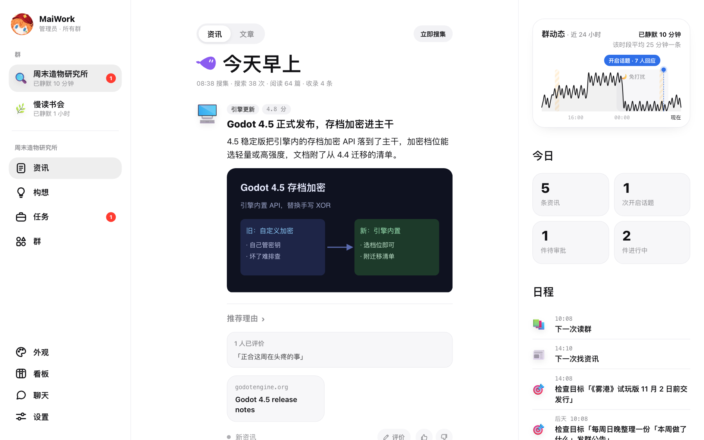
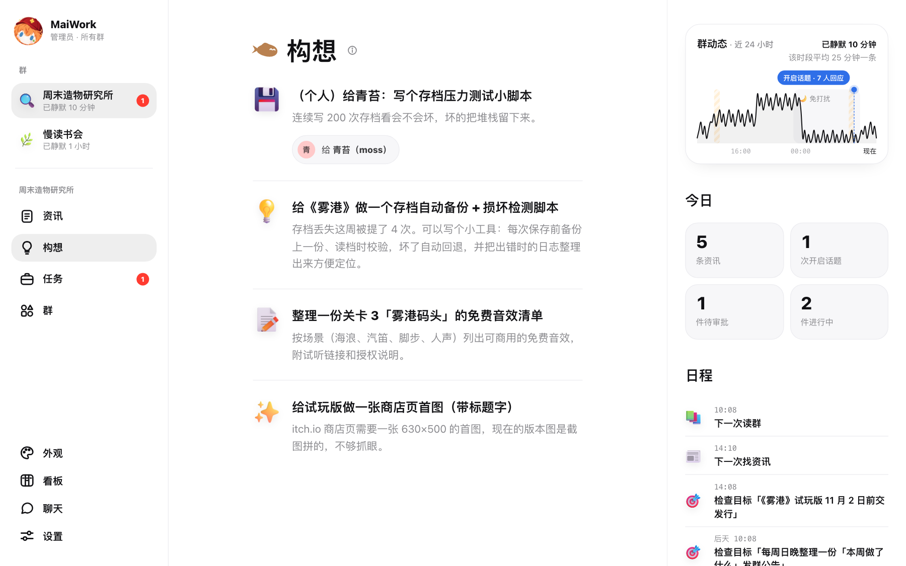
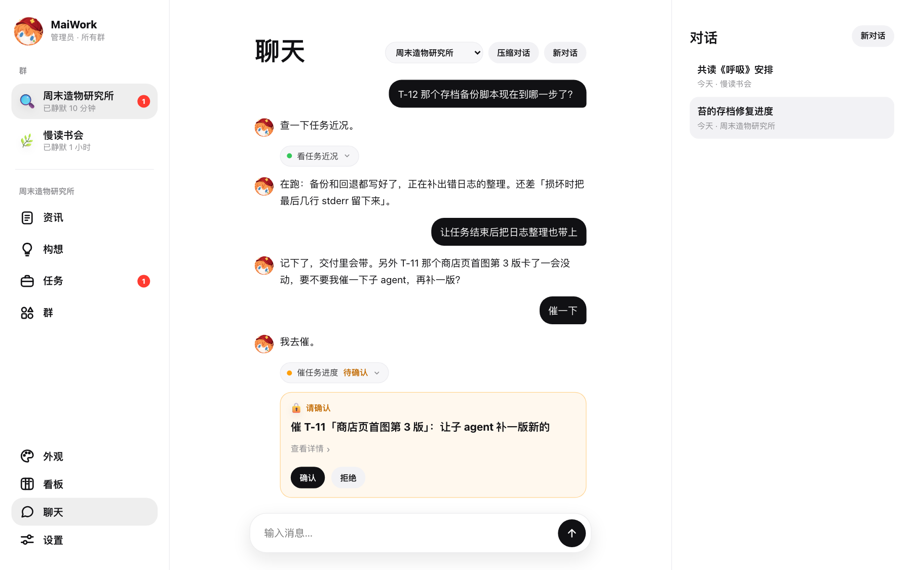
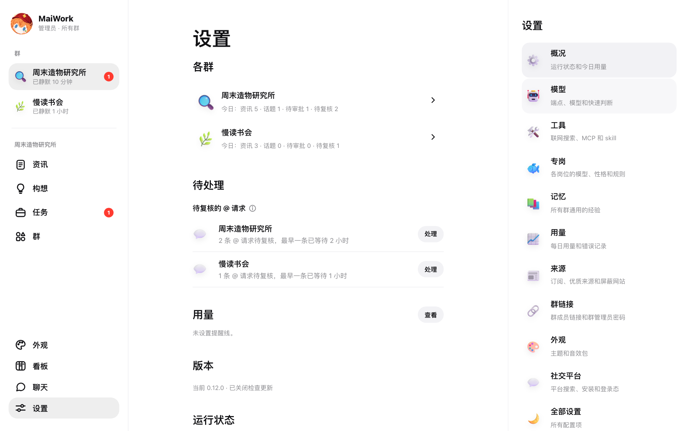
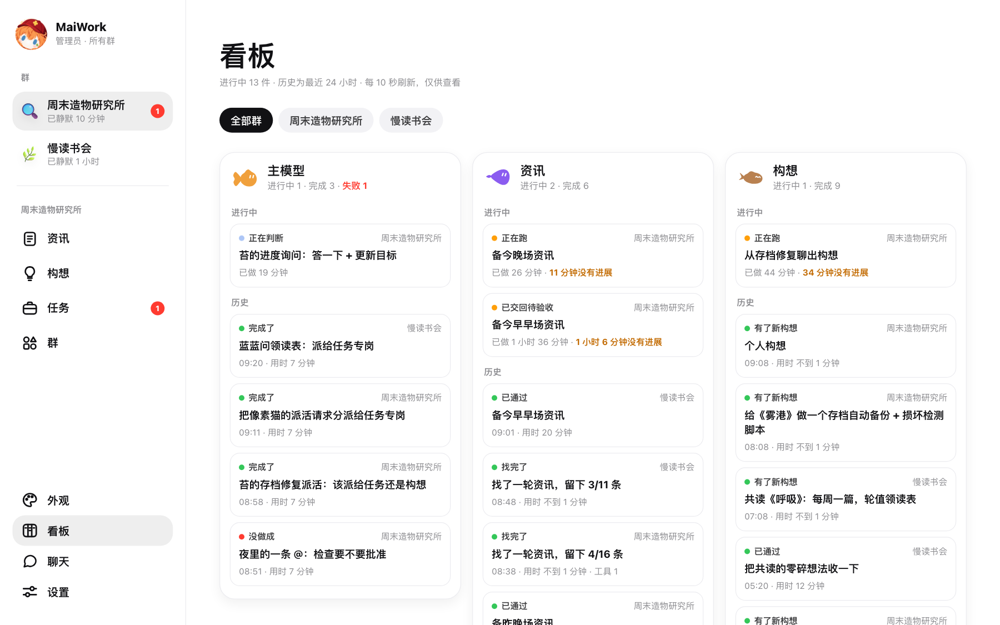
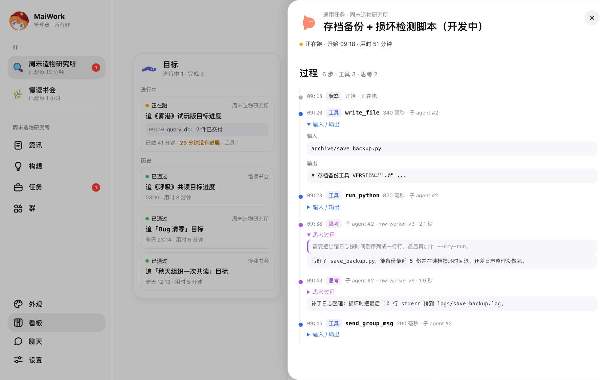

<div align="center">


# MaiWork

**给 MaiBot 配一个真正在群里干活的搭档**：懂这个群 · 主动找资讯 · 提点子 · 盯长期目标 · 接活做完交出来

[](https://github.com/CharTyr/MaiWork/releases)
[](https://github.com/Mai-with-u/MaiBot)
[](https://github.com/Mai-with-u/MaiBot)
[](LICENSE)
[](https://github.com/CharTyr/MaiWork/stargazers)
[](https://github.com/CharTyr/MaiWork/issues)

[它能干什么](#核心特性) • [界面一览](#界面一览) • [运行环境](#运行环境) • [三步用起来](#快速开始) • [群指令](#指令) • [安全与隐私](#安全与隐私) • [常见问题](#常见问题) • [详细指南](#详细文档)

**在线看网页演示：[dewy-vow-gebh.here.now](https://dewy-vow-gebh.here.now/)**

</div>

> MaiWork 是 MaiBot 的插件（ID `chartyr.maiwork`）。它跟 MaiBot **并行运行、不抢话筒**：平时聊天还是 MaiBot 聊，MaiWork 在后台默默记下群里关心什么，主动找资讯、想点子、接大家派的活，做完了再通过网页、群文件或让 MaiBot 顺口提一句交出来。

<div align="center">

</div>
<div align="center">

</div>

---

## 核心特性

| 能干什么 | 具体怎么做 |
|------|------|
| **主动找资讯** | 每天固定几个时段，按群里最近聊的话题上网搜新消息，逐篇打开原文核实、筛掉水文和旧闻，只留真值得看的 |
| **提点子、盯目标** | 从群聊里想到「这件事我可以帮你们做」并列出步骤；需要长期跟进的事立成目标，定期自己往前推 |
| **接活、连续改、真验收** | 群友 @MaiBot 派活（查资料、写对比报告、做小工具、出文档），做完先过一遍验收才交付；开工后派活的人在群里直接 @ 它就能补充要求、追问进度、让它重改 |
| **画图、报告页、办公文档** | 调研类任务做成手机电脑都好读的报告网页；配一个生图模型就能画插画和封面；Word / Excel / PPT 组件在网页上一键安装 |
| **克制不刷屏** | 主动往群里发的消息每天有条数上限，睡觉时段绝不打扰；大部分内容安安静静放在本群网页上 |
| **管理员握着方向盘** | 群友派的活默认要管理员批准才能动工；低风险小活可以开自动放行（随时能关） |
| **自带网页工作台** | 每个群有自己的资讯 / 构想 / 在做的事 / 群页面；管理员还能在网页上直接跟 MaiWork 聊天查日志、试工具、改设置，或在「看板」里看每个岗位正在忙什么 |
| **对接你自己的 Agent** | 不想让 MaiWork 自己跑的任务，可以一键把群里的来龙去脉打包，带回你自己的私人 Agent 接着做 |

每项功能的细节见[功能详解](docs/guide/features.md)。

---

## 界面一览

<table>
<tr>
<td width="50%"><br /><sub><b>构想</b>：从群聊里想到能帮上忙的事，拆成清楚的几步</sub></td>
<td width="50%"><br /><sub><b>任务</b>：等批准、进行中、已交付；每一步做了什么都摊开给你看</sub></td>
</tr>
<tr>
<td width="50%"><br /><sub><b>和 MaiWork 聊</b>：管理员直接问进度、查原因、改设置；动真格的操作先出确认卡</sub></td>
<td width="50%"><br /><sub><b>设置概况</b>：各群今天的情况、待处理的事、花销和运行健康度一页看清</sub></td>
</tr>
</table>

### 看板

总管理员专属的「透明机房」：主模型、资讯、构想、目标、通用任务、开话题各占一栏，现在谁在忙、刚干完什么一目了然；卡住超过 10 分钟的会醒目标出来。

<div align="center">

</div>

点开任意一件活，能顺着时间线看清全过程：调了哪个工具、传了什么参数、耗时多久、模型怎么想的、岗位之间互相留了什么便条。

<div align="center">

</div>

<div align="center">

<br /><sub>手机上也好用：看资讯、批任务、翻报告页都顺手</sub>
</div>

截图来自[在线演示](https://dewy-vow-gebh.here.now/)，里面的群、成员和内容都是虚构演示数据。

---

## 运行环境

- **MaiBot**：插件 SDK 2.x（在 MaiBot 1.3.2 上实测），所需的 Python 依赖 MaiBot 自带，不用额外装包。
- **大模型**：准备一家兼容 OpenAI / Anthropic / Responses 接口的模型服务商密钥，装好后在网页引导里填。
- **联网搜索**：网页引导里直接勾一个现成的搜索服务（有免密钥的）；只订 RSS 也能出资讯。
- **跑代码 / 跑命令的活**：
  - 如果 MaiBot 以 root 跑在带 systemd 的 Linux 上，MaiWork 会自动用系统隔离环境在本机安全跑命令；
  - 如果在 Windows、macOS、Docker 或非 root 环境下，本机不直接跑命令，查资料、写网页照常能做；需要跑命令的活会自动交给一次性云端临时机器（默认用免密钥的 Railway，也可配 Freestyle）或你自己的服务器。

详见[运行环境与干活的机器](docs/guide/environment.md)。如果 **MaiBot 装在 Docker 里**，请先看 [Docker 部署指南](docs/guide/docker.md)。

---

## 快速开始

最快用起来只需三步：**装插件 → 填上群号 → 打开网页跟着向导点完**。

### 第一步：安装插件

二选一：
- **插件市场**：在 MaiBot WebUI → 插件市场 → 搜索「MaiWork」点击安装。
- **手动安装**：进入 MaiBot 的 `plugins/` 目录执行：
  ```bash
  git clone https://github.com/CharTyr/MaiWork.git
  ```

### 第二步：开启插件，填上要服务的群

把插件目录里的 `config.example.toml` 复制成 `config.toml`（或在 MaiBot WebUI 的插件配置页里改），只需要改两处：

```toml
[plugin]
enabled = true

[[groups.serve]]
group = "qq:123456789"   # 换成你的 QQ 群号；Telegram 或 QQ 官方机器人见「配置说明」
```

保存后 MaiBot 会自动加载插件。**没写进这里的群，MaiWork 连消息都不会读。**

### 第三步：打开网页，跟着首次向导走完

1. 去 `<MaiBot>/data/maiwork/console_password.txt` 看一眼自动生成的管理员密码（你也可以在 `config.toml` 的 `[console] password` 里自己指定）。
2. 浏览器打开 `http://127.0.0.1:18650`，输入密码登录。
3. 跟着网页上的**首次引导**走完几步：
   - **接模型**：选接口格式、填服务商地址和密钥，挑一个模型（保存时会自动发一句极短的测试话验证能不能用）。
   - **确认服务群与批准人**：核对服务哪个群、填上你自己的账号（群友派活由你批）。
   - **勾一个联网搜索**：直接勾预设服务，排第一的当主搜索，其余当替补。
   - **快速判断模型（可跳过）**：用来低成本快速识别群里的 @ 是不是在派活；不填也能用，以后随时能在网页「设置 → 模型」下半页补。
4. 走到**完成页**，它会像体检表一样列出「模型 / 群 / 搜索 / 干活环境 / 办公文档 / 交付渠道」哪项通了、哪项还缺什么，点旁边的按钮就能直接去补齐。

> 以后改任何设置都直接在网页上点，不用手改配置文件，也不用重启 MaiBot。

### 第四步：回群里试试

- 在群里发 `/mw` 看当前进展，发 `/mw 网页` 拿这个群的专属网页链接。
- 发 `/mw 帮助` 查看所有群指令和一句话例子。
- 直接在群里 @ 机器人派个活，比如：「`@MaiBot 帮我对比一下这三款机械键盘的优缺点，做个网页表格`」。
- 任务开工后，你再 @ 机器人就能直接跟它连续对话：补充条件、问做到哪了、让它按新想法重改，或者说「结束」收尾。

---

## 指令

记不住没关系，在群里发 `/mw 帮助`（或 `/mw ?`）随时能调出这份清单：

| 群里发什么 | 干什么用 | 谁能用 |
|:-----|:-----|:-----|
| `/mw` | 看本群正在跑的目标、任务和等批准的事 | 群里所有人 |
| `/mw 帮助` | 列出所有指令和例子 | 群里所有人 |
| `/mw 网页` | 获取本群的网页链接 | 群里所有人 |
| `/mw do 要做的事` | 不走判断直接派活（也可以先引用一条群消息再发 `/mw do`） | 群里所有人 |
| `/mw 批准 [编号]` | 批准群友派的任务或目标 | **本群**批准人（在网页「群 → 任务审批」里设） |
| `/mw 拒绝 [编号]` | 拒绝任务或目标 | **本群**批准人 |
| `/mw 取消 [编号]` | 取消任务（`T-`）、目标（`G-`）或提醒（`M-`） | 发起人本人、群主/群管、本群批准人 |
| `/mw 领取 T-编号` | 当场重发一次已经做完的成品 | 群里所有人 |

> **总管理员 vs 群管理员**：总管理员能看所有群、改全局设置；你还可以给每个群单独设一个群管理员密码，让那个群的管理员只管自己群的审批、群规和推送开关。

---

## 安全与隐私

- **不越界**：没写进配置的群，一条消息都不碰。
- **不泄密**：网页上填过的 API 密钥只进不出，不会再回显，也不会被写进聊天或日志。
- **不把私下画像发到群里**：关注成员的个人画像只给管理员在后台参考，绝不出现在群消息里，也不跨群。
- **公开链接有期限**：发给群友看成品或本群页面的 here.now 临时链接，在 24 小时有效期内拿到链接的人都能打开——请不要让它处理包含个人隐私或商业机密的内容。

群文件、群公告、群相册的权限边界见[安全与公开范围](docs/guide/security.md)。

---

## 常见问题

**Q：我用的是 Windows 或 macOS，能用吗？**
A：完全能用。资讯、构想、目标、网页、查资料写报告都一模一样。唯一区别是 Windows / macOS 本机不做系统隔离，遇到要跑代码或敲命令的活，它会自动借用云端的一次性临时机器（Railway 默认开着、免注册免密钥，只要电脑里有 `ssh` 命令就行；也可以换用 Freestyle）。

**Q：Windows 上用 Railway 临时机器要装 WSL2 吗？**
A：不用。Windows 10/11 自带 OpenSSH 客户端，只要在 PowerShell 里输 `ssh -V` 有显示版本号就能直接用。如果提示找不到命令，去 Windows「设置 → 系统 → 可选功能」里装上「OpenSSH 客户端」就行，详见[Windows / macOS 上怎么用 Railway](docs/guide/environment.md#windows--macos-上怎么用-railway不用-wsl2)。

**Q：需要我自己在 Linux 上建一个 `maiwork` 系统用户吗？**
A：不用。只要 MaiBot 以 root 跑在有 systemd 的 Linux 上，MaiWork 会自动用临时隔离账号跑任务；如果你以前建过 `maiwork` 账号，它也会直接沿用。

**Q：任务做好了，为什么群里没收到群文件，只发了个网页链接？**
A：往 QQ 群传文件需要两件事同时满足：① MaiBot 装的适配器支持传群文件（如 SnowLuma 适配器）；② NapCat 和 MaiBot 能访问同一块磁盘（如果 NapCat 装在另一个 Docker 容器或 WSL 里，MaiWork 会自动尝试把 20MB 以内的文件内容直接传过去；还是不行就会改发网页链接，并在网页「设置 → 运行状态」里告诉你具体卡在哪）。

**Q：群友看网页需要我自己买域名、配反向代理吗？**
A：不用。MaiWork 默认会把群友要看的页面自动发到 here.now（匿名临时网页，24 小时过期）。以后你想换用自己的固定域名了，再去设置里填 `public_url` 即可；不想公开也可以随时关掉。

**Q：为什么装好之后群里一点动静都没有？**
A：为了不乱打扰，插件刚装上默认是关着的。请确认两件事：① `config.toml` 里写了 `enabled = true` 和至少一个服务群；② 打开 `http://127.0.0.1:18650` 走完了首次引导、配好了模型。

**Q：资讯页一直是空的怎么办？**
A：找资讯得能联网。去网页「设置 → 工具」勾选一个搜索服务（有免密钥的预设），或者在群页绑几个 RSS 源，到下一个资讯时段就会开始出内容了。

**Q：它会在群里话太多、刷屏吗？**
A：不会。平时聊天全是 MaiBot 的事；MaiWork 自己往群里发的主动消息（冷场开话题、资讯卡片、构想提一嘴）加起来每群每天默认最多 3 条，晚上免打扰时段一条不发。

**Q：MaiBot 是用 Docker 装的，能用吗？**
A：能用。需要把数据目录挂到容器外、把网页端口映射出来；MaiWork 会自动识别 Docker 环境，并在首次引导和「设置 → 运行状态」里逐条提示你哪项还没配好。完整步骤见 [Docker 部署指南](docs/guide/docker.md)。

---

## 详细文档

| 指南 | 讲什么 |
|:-----|:-----|
| [功能详解](docs/guide/features.md) | 资讯怎么筛、点子与长期目标怎么推、任务怎么验收与连续改、网页工作台各页干什么用 |
| [配置说明](docs/guide/configuration.md) | 模型、搜索、本群规矩与做法、多平台怎么配，以及 `config.toml` 常用项速查 |
| [运行环境与干活的机器](docs/guide/environment.md) | 本机隔离、怎么挂自己的服务器、怎么用 Railway / Freestyle 临时机器 |
| [Docker 部署](docs/guide/docker.md) | MaiBot 跑在 Docker 容器里时要注意的 7 件事 |
| [升级说明](docs/guide/upgrade.md) | 最近几版加了什么新功能、从老版本升上来要注意什么 |
| [安全与公开范围](docs/guide/security.md) | 哪些内容会公开、群文件与群公告能动什么、隐私怎么兜底 |

---

## 支持与致谢

如果 MaiWork 帮到了你的群，欢迎点亮一颗 Star；遇到问题或有新想法，随时提 [Issue](https://github.com/CharTyr/MaiWork/issues) 或 [Pull Request](https://github.com/CharTyr/MaiWork/pulls)。

- [MaiBot](https://github.com/Mai-with-u/MaiBot) 开源聊天机器人框架
- [here.now](https://here.now) 临时网页托管
- [railway.new](https://railway.new) 免密钥一次性云端机器
- [Freestyle](https://www.freestyle.sh) 一次性云端机器

## 许可证与作者

本项目采用 **AGPL-3.0-or-later** 开源协议：你可以自由使用、修改和分发；如果你修改了代码并对外提供服务（包括网页控制台），需要开放修改后的源码。

[@CharTyr](https://github.com/CharTyr)
